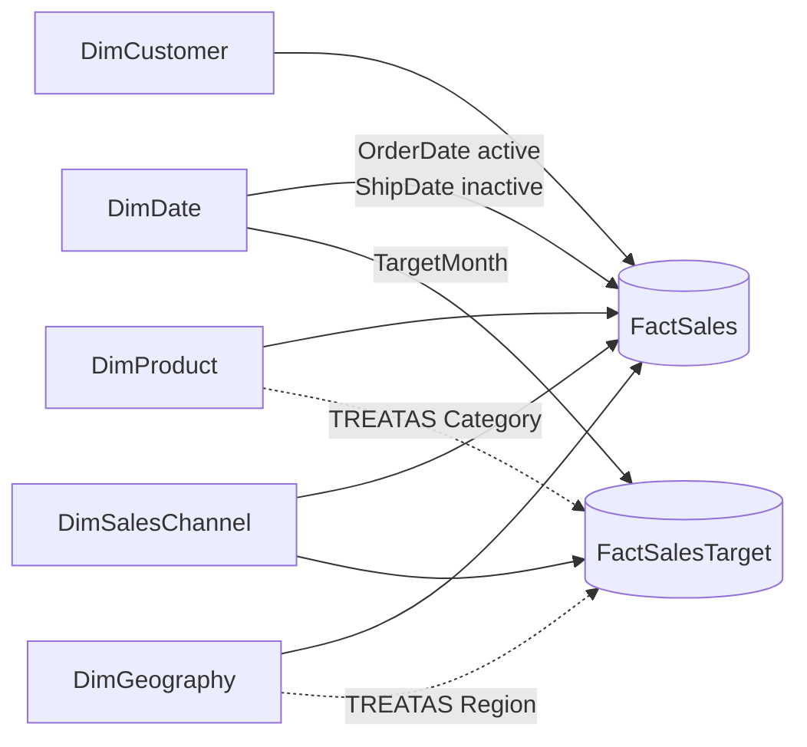

# Sales Performance & Business Intelligence Dashboard

**An end-to-end Power BI solution that turns raw sales exports into trusted KPIs, target tracking and decisions.**

`Power BI` `DAX` `Power Query` `Data Modeling` `Star Schema` `Sales Analytics` `KPI Dashboard` `Data Visualization` `Business Reporting` `Python`

> **Portfolio project with synthetic data.** Meridian Home & Office Co. is a fictional retailer. All data was generated by a reproducible script and contains no real customer or company information.

---

## Contents

- [Business problem](#business-problem) · [Objectives](#objectives) · [Tools](#tools-and-technologies)
- [Dataset](#dataset) · [Data cleaning](#data-cleaning) · [Data model](#data-model) · [DAX measures](#key-dax-measures)
- [Dashboard pages](#dashboard-pages) · [Example findings](#example-findings-synthetic-data) · [Reproduce](#how-to-reproduce)
- [Project status](#project-status) · [Limitations](#known-limitations) · [Future improvements](#future-improvements)

## Business problem

A multi-channel retailer (Online, Retail Stores, Marketplace, B2B Wholesale) selling four product categories across four US regions reports performance from hand-built spreadsheets. Numbers change between versions, leaders see *that* sales moved but not *why*, and finance targets are compared with actuals only at quarter end.

## Objectives

- One trusted, reproducible version of sales, profit and target data.
- A KPI framework covering revenue, profitability, growth, targets, product mix and customer behaviour.
- An executive dashboard that answers "are we on track?" in seconds, with drill-down to the drivers.
- Clear, evidence-based recommendations for management.

**Business questions answered:** How much revenue are we generating? Are sales and profit growing? Which products, categories, regions and channels perform best? Are we hitting target? What is underperforming? What drives profitability? Which customers matter most? What should management do next?

## Tools and technologies

| Layer | Tools |
|---|---|
| Reporting & analytics | Microsoft Power BI Desktop, DAX, Power Query (M), TMDL |
| Data preparation & testing | Python 3 (pandas, numpy, openpyxl) |
| Sources | CSV and Excel extracts |
| Documentation & versioning | Markdown, Mermaid diagrams, Git/GitHub |

## Dataset

| Table | Rows | Description |
|---|---|---|
| FactSales | 31,952 | Order lines, Jan 2023 - Dec 2025 (16,472 orders) |
| FactSalesTarget | 2,304 | Monthly targets by region, category and channel |
| DimDate | 1,096 | Daily calendar 2023-2025 |
| DimProduct | 71 | 4 categories, 16 subcategories |
| DimCustomer | 1,400 | 3 segments, value tiers, purchase frequency |
| DimGeography | 29 | Cities in 4 regions / 21 states |
| DimSalesChannel | 4 | Online Store, Retail Stores, Marketplace, B2B Wholesale |

The generator simulates a business rather than random rows: seasonality, regional growth differences, channel-mix shifts, customer concentration, discount policies and finance targets set from prior-year actuals. See [docs/data_dictionary.md](docs/data_dictionary.md) for every column.

**Revenue and profit definitions:** `GrossSales = Quantity x UnitPrice` → `DiscountAmount = GrossSales x DiscountPct` → **`Sales (net) = GrossSales - DiscountAmount`** → `Profit = Sales - Quantity x UnitCost`. Discounts are applied before revenue is recognised.

## Data cleaning

The raw ERP export deliberately contains the problems real projects face. Every rule is scripted, logged with row counts and tested:

| Issue | Rows | Resolution |
|---|---|---|
| Exact duplicate rows | 159 | Removed |
| Test-account orders | 6 | Removed |
| Inconsistent category / region casing | 452 / 319 | Conformed to master lists |
| Legacy channel names (`Web Store`, `Wholesale`...) | 958 | Mapped to 4 channels |
| Line totals that ignored the discount | 40 | Recomputed from components ($2,079 overstatement removed) |
| Blank ship dates | 138 | Kept blank - verified as open orders, not imputed |
| `Mid-West` spelling in finance targets | 162 | Mapped to `Midwest` |

Details: [docs/data_cleaning.md](docs/data_cleaning.md) · Log: [docs/validation_report.md](docs/validation_report.md)

## Data model



- Star schema, order-line grain, one-to-many single-direction relationships, no ambiguous paths.
- `DimDate` marked as date table; ship date via an inactive relationship (`USERELATIONSHIP`).
- Targets live at Month x Region x Category x Channel. Region and category are applied with `TREATAS`, and the target measure **returns blank below target grain** so a product or state is never compared with a whole-category or whole-region target.

Full rationale: [docs/data_model.md](docs/data_model.md)

## Key DAX measures

78 explicit measures in a `_Measures` table, in seven display folders. Full library: [powerbi/dax_measures.md](powerbi/dax_measures.md) · deployable script: [powerbi/tmdl/measures.tmdl](powerbi/tmdl/measures.tmdl)

| Folder | Examples |
|---|---|
| Sales | Total Sales, Total Orders, Average Order Value, Average Selling Price |
| Profitability | Profit Margin %, Discount Rate %, List Margin %, Margin Erosion from Discounts, Loss-Making Sales |
| Time Intelligence | Sales MoM / YoY Growth %, Sales YTD, Sales PYTD, Rolling 3M Avg |
| Targets | Sales Target, Target Achievement %, Remaining Sales to Target, Target Status Color |
| Product & Customer | Contribution %, Product Sales Rank, Top 10 Products Share %, Top 20% Customers Share %, Repeat Customer Rate %, New Customers |
| Labels & UX | Report Period Label, Filter Context Summary, dynamic titles |

```dax
Sales YoY Growth % = DIVIDE ( [Sales YoY Change], [Sales Previous Year] )

Sales YoY Change =
VAR CurrentSales = [Total Sales]
VAR PriorSales = [Sales Previous Year]
RETURN
    IF ( NOT ISBLANK ( CurrentSales ) && NOT ISBLANK ( PriorSales ), CurrentSales - PriorSales )
```

Comparison measures return blank, not ±100%, when there is no comparison period.

## Dashboard pages

| Page | Business question | Highlights |
|---|---|---|
| 1. Executive Sales Overview | How is the business performing, and where should we focus? | 6 KPI cards with status colours, sales vs target trend, profit trend, region and category mix, insight panel |
| 2. Sales Trend Analysis | How does performance change over time? | Seasonality by year, quarterly YoY, MoM and YTD, drill-down matrix |
| 3. Product Performance | What drives sales and profit? | Category > subcategory > product drill, Top/Bottom 10, sales-vs-margin quadrant |
| 4. Regional Performance | Which regions hit target? | Region scorecard, sales vs target, small-multiple trends, state matrix, optional map |
| 5. Customer Insights | Who are our most valuable customers? | Top customers, Pareto/value tiers, segments, new vs returning |
| 6. Profitability & Discounts | Where are margins lost? | Margin by discount band, discount-vs-margin scatter, category x region heatmap, drivers table |

Plus Product Detail and Customer Detail drill-through pages and a margin tooltip page. Interactions: synced Year/Region/Category/Channel slicers, cross-filtering, date and product drill-down, page navigation, reset-filters bookmark, dynamic titles. Layout spec with pixel positions: [docs/dashboard_design.md](docs/dashboard_design.md).

### Screenshots

> **Placeholders** - the report pages are built in Power BI Desktop from the specification; screenshots will be added here after that build (see [docs/screenshots/README.md](docs/screenshots/README.md)).

| Executive Overview | Profitability & Discounts |
|---|---|
| *docs/screenshots/01_executive_overview.png (pending)* | *docs/screenshots/06_profitability_discounts.png (pending)* |

## Example findings (synthetic data)

*Illustrative findings calculated from the generated dataset - full analysis in [docs/business_insights.md](docs/business_insights.md).*

- **$9.15M net sales, 28.2% margin** over 2023-2025. Sales grew **13.1%** in 2024, then were **flat (-0.3%)** in 2025, closing at **90.7% of target** ($323.6K short).
- The 2025 gap traces to **B2B Wholesale (-6.0%)**, half of revenue. Online (+6.3%) and Marketplace (+18.9%) kept growing. The fall in average order value is a **channel-mix effect**, not price erosion.
- **Laptops are 25.5% of sales at a 10.5% margin** - a structural cost/price issue, since they are rarely discounted.
- Discounts cut margin by **5.2 percentage points**; lines discounted more than 30% **lost money**.
- The **top 20% of customers generate 71.7%** of sales.
- **Nov-Dec deliver ~21% of annual sales** in every year - a repeatable seasonal peak.

## How to reproduce

```bash
git clone <your-repo-url> && cd sales-performance-bi-dashboard
pip install -r requirements.txt
python scripts/generate_sales_data.py      # synthetic raw extracts (seed 42)
python scripts/prepare_data.py             # cleaning + star schema -> data/processed
python scripts/build_powerbi_assets.py     # Power Query M, TMDL measures, data dictionary
python scripts/calculate_kpis.py           # expected KPI values for validation
python scripts/validate_data.py            # 17 automated checks -> docs/validation_report.md
```

Then build the report in Power BI Desktop with [powerbi/README.md](powerbi/README.md) and validate it against [docs/kpi_reference.md](docs/kpi_reference.md).

## Repository structure

```text
sales-performance-bi-dashboard/
├── data/
│   ├── raw/                 # synthetic source extracts (CSV + Excel), with data issues
│   ├── processed/           # clean star schema, cleaning log, reference KPIs
│   └── README.md
├── scripts/
│   ├── generate_sales_data.py
│   ├── prepare_data.py
│   ├── schema.py            # single source of truth for tables/columns
│   ├── measures.py          # single source of truth for DAX measures
│   ├── build_powerbi_assets.py
│   ├── calculate_kpis.py
│   └── validate_data.py
├── powerbi/
│   ├── README.md            # step-by-step build guide
│   ├── dax_measures.md
│   ├── tmdl/measures.tmdl
│   ├── power_query/*.pq
│   └── theme/meridian_executive_theme.json
├── docs/
│   ├── business_requirements.md   ├── data_cleaning.md     ├── data_dictionary.md
│   ├── data_model.md              ├── dashboard_design.md  ├── business_insights.md
│   ├── kpi_reference.md           ├── testing_and_validation.md
│   ├── validation_report.md       ├── portfolio_case_study.md
│   ├── upwork_portfolio_description.md
│   └── screenshots/
├── tests/data_quality_checks.py
├── requirements.txt
└── README.md
```

## Project status

| Deliverable | Status |
|---|---|
| Synthetic dataset, cleaning pipeline, star-schema CSVs | ✅ Done and validated (17/17 automated checks) |
| Data dictionary, model specification, ER diagram | ✅ Done |
| DAX library (78 measures) - docs + TMDL script | ✅ Written and statically linted · ⏳ execution to be verified in Power BI |
| Power Query scripts, report theme | ✅ Done |
| Six-page report specification | ✅ Done |
| Power BI report (.pbip), screenshots | ⏳ To be built in Power BI Desktop ([guide](powerbi/README.md)) |
| Business insights, case study, Upwork text | ✅ Done |

## Known limitations

- Synthetic data: some patterns were designed into the generator; findings demonstrate method, not market facts.
- No data before 2023 (2023 YoY is blank; all 2023 buyers count as new).
- Profit is gross profit only - no overheads, freight, returns or marketing spend.
- Targets exist only at Month x Region x Category x Channel.
- Customer value tiers are static (2023-2025 history).

## Future improvements

- Publish to the Power BI service with scheduled refresh and row-level security by region.
- Replace CSVs with a SQL database or SharePoint folder (only the `DataFolder` parameter changes).
- Add returns, freight cost and marketing spend for net profitability and ROI.
- Forecasting (Power BI analytics forecast or a Python model) and what-if discount scenarios.
- Calculation groups for time intelligence to reduce measure count.
- Automated DAX tests with the Power BI REST API `executeQueries` endpoint against a published model.

## Author

[Your name] - Power BI Developer & Data Analyst · [LinkedIn] · [Upwork profile]
