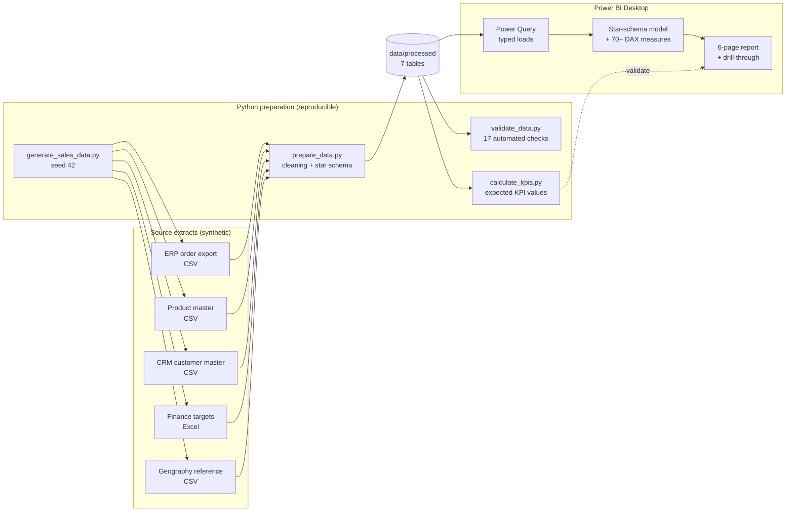

# Business Requirements & Project Plan

> **Scenario note:** Meridian Home & Office Co. is a **fictional** US retailer created for this portfolio project. All data is synthetic. Nothing here describes a real company or a real client engagement.

## 1. Business problem

Meridian sells electronics, furniture, office supplies and home & kitchen products to consumers, small businesses and corporate accounts through four channels (Online Store, Retail Stores, Marketplace, B2B Wholesale) across four US regions.

Today, performance reporting is a monthly spreadsheet assembled by hand from an ERP order export, a CRM customer list and a finance target workbook. The management team has three recurring complaints:

1. **No single version of the numbers.** Sales differs between reports because duplicates, test orders and inconsistent channel/region names are cleaned differently each month.
2. **Results without reasons.** Leaders can see that sales are up or down, but not *which* region, channel, product or customer group drove the change, or whether margin is being given away through discounts.
3. **Targets are tracked late.** Finance targets live in a separate workbook and are compared to actuals only at quarter end.

**Goal:** a centralised, self-service Power BI solution that gives executives a trusted view of sales, profit and target attainment, and lets managers drill into the drivers.

## 2. Target users

| User | Needs | Primary pages |
|---|---|---|
| CEO / executive team | Is the business on track? Where should we focus? | Executive Overview |
| Sales director / regional managers | Region and channel performance vs target; trends | Executive Overview, Regional Performance, Sales Trends |
| Category / merchandising managers | Which products drive sales and margin; underperformers | Product Performance, Profitability & Discounts |
| Finance (FP&A) | Margin drivers, discount cost, target variance | Profitability & Discounts, Executive Overview |
| Account management / CRM | Customer concentration, repeat behaviour, key accounts | Customer Insights |

## 3. Business questions and how the solution answers them

| # | Business question | Answered by |
|---|---|---|
| Q1 | How much revenue is the business generating? | Total Sales, Sales YTD (Executive, Trends) |
| Q2 | Are sales and profits increasing or decreasing? | YoY / MoM / YTD growth measures, monthly trends (Trends) |
| Q3 | Which products and categories generate the most revenue? | Category/subcategory bars, Top 10 products, contribution % (Product) |
| Q4 | Which regions and channels perform best? | Region and channel comparisons with margin and target (Regional, Executive) |
| Q5 | Are we achieving our sales targets? | Sales Target, Target Achievement %, Remaining to Target (Executive, Regional) |
| Q6 | Which products or regions are underperforming? | Bottom products, margin status colouring, below-target regions |
| Q7 | What are the main drivers of profitability? | Margin by category/subcategory, discount bands, list vs realised margin (Profitability) |
| Q8 | Which customers contribute the most to sales? | Top customers, Pareto share, value tiers (Customer) |
| Q9 | What actions should management take? | Insight panels and docs/business_insights.md |

## 4. KPI framework

| Area | KPIs | Definition summary |
|---|---|---|
| Sales | Total Sales, Total Orders, Units, Customers, AOV, ASP | Sales = **net** sales after line discounts |
| Profitability | Total Profit, Profit Margin %, Avg Profit/Order, Discount Rate %, List Margin %, Margin Erosion | Profit = net sales - cost of goods |
| Growth | MoM, YoY, YTD vs PYTD, Rolling 3M | Blank when no comparison period exists |
| Targets | Sales Target, Sales vs Target, Achievement %, Remaining, YTD Achievement | Target grain: Month x Region x Category x Channel |
| Mix & concentration | Product/Category/Customer contribution %, Top 10 share, Top 20% customer share | Share of the slicer selection |
| Customers | Repeat rate, New vs Returning, Orders per Customer | Behaviour within the selected period |
| Operations | Average Days to Ship, Open Orders | Order-level |

Full definitions: [`powerbi/dax_measures.md`](../powerbi/dax_measures.md).

## 5. Report pages

1. **Executive Sales Overview** - headline KPIs, sales vs target trend, profit trend, region/category mix, insight panel.
2. **Sales Trend Analysis** - monthly/quarterly trends, YoY and MoM, seasonality, sales vs profit.
3. **Product Performance** - category > subcategory > product, Top/Bottom N, sales-vs-margin quadrant.
4. **Regional Performance** - region and state comparison, target attainment, regional trends, optional map.
5. **Customer Insights** - concentration, top customers, segments, value tiers, repeat behaviour.
6. **Profitability & Discount Analysis** - margin drivers, discount bands, loss-making lines, low-margin products.

Supporting pages: Product Detail and Customer Detail (drill-through), Margin tooltip page.

Common interactions: Year/date, Region, Category and Channel slicers on every page (synced), cross-filtering, date and product drill-down, page navigation buttons, reset-filters bookmark, dynamic titles. Details in [`dashboard_design.md`](dashboard_design.md).

## 6. Solution architecture

**Why clean in Python and load typed CSVs into Power Query?** The cleaning rules (de-duplication, conforming names, recomputing totals) are version-controlled, unit-tested and produce an audit log. Power Query then performs a thin, typed load that is easy to repoint at a database or SharePoint folder later. For a client with live sources, the same rules would move into Power Query or a dataflow; the documented rules make that port straightforward.

## 7. Assumptions

- Sales means **net sales** (after line discounts). Discounts are applied before revenue is recognised.
- Profit is **gross profit** (net sales - standard cost). Overheads, freight, returns and taxes are not in the source data.
- Currency is USD. No FX.
- The ship-to location of an order is the customer's city; customers do not move during the period.
- Targets are set by finance at Month x Region x Category x Channel. No targets exist for states, products or customers.
- Calendar year = fiscal year.
- The extract date is 31 Dec 2025. Orders not shipped by then are **Open** with a blank ship date.

## 8. Data limitations

- **Synthetic data.** Patterns such as seasonality, regional growth differences and discount policies were deliberately built into the generator; other variation is random. Findings demonstrate the analytical method, not real market facts.
- **No history before 2023.** 2023 YoY measures are blank and every 2023 buyer counts as a "new" customer.
- **No returns, cancellations, marketing spend or inventory**, so ROI, return rates and stock-outs cannot be analysed.
- **Targets are coarse-grained** (see assumptions), so target measures intentionally return blank at finer filter levels.
- **Customer segmentation tiers are static** (based on full 2023-2025 history), while repeat/new measures are dynamic.

## 9. Implementation plan and status

| Phase | Deliverable | Status |
|---|---|---|
| 1. Planning | This document, KPI framework, page plan | Done |
| 2. Data preparation | Generator, raw extracts, cleaning script, cleaning log, data dictionary | Done, validated |
| 3. Data modelling | Star schema CSVs, model specification, ER diagram | Done (spec); model is built in Power BI Desktop by following `powerbi/README.md` |
| 4. DAX | Measure library (docs + TMDL script), static lint | Done; **DAX execution must be verified in Power BI Desktop** against `docs/kpi_reference.md` |
| 5. Dashboard design | Theme JSON, page layouts, interactions, storytelling | Specification done; **report pages must be built in Power BI Desktop** |
| 6. Validation | Automated data checks; manual Power BI checklist | Automated: done. Manual: pending Power BI build |
| 7. Portfolio | README, case study, Upwork description | Done; screenshots pending Power BI build |
