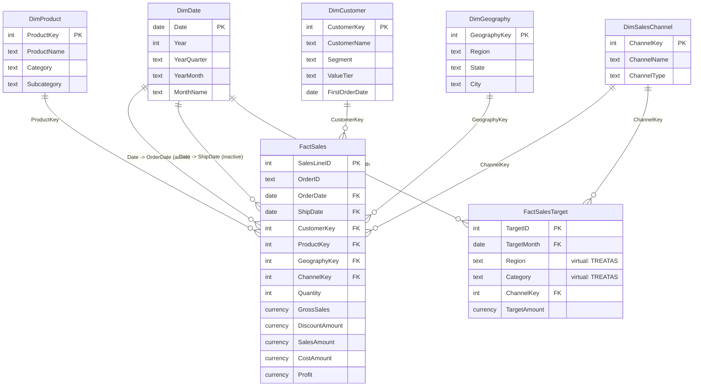

# Data Model

A star schema with two fact tables at different grains sharing conformed dimensions.

## 1. Diagram

Measures live in a separate, otherwise empty table `_Measures`.

## 2. Relationships to create in Power BI Desktop

| # | From (many side) | To (one side) | Cardinality | Cross-filter | Active |
|---|---|---|---|---|---|
| 1 | FactSales[OrderDate] | DimDate[Date] | Many-to-one | Single | Yes |
| 2 | FactSales[ShipDate] | DimDate[Date] | Many-to-one | Single | **No** (used with `USERELATIONSHIP`) |
| 3 | FactSales[ProductKey] | DimProduct[ProductKey] | Many-to-one | Single | Yes |
| 4 | FactSales[CustomerKey] | DimCustomer[CustomerKey] | Many-to-one | Single | Yes |
| 5 | FactSales[GeographyKey] | DimGeography[GeographyKey] | Many-to-one | Single | Yes |
| 6 | FactSales[ChannelKey] | DimSalesChannel[ChannelKey] | Many-to-one | Single | Yes |
| 7 | FactSalesTarget[TargetMonth] | DimDate[Date] | Many-to-one | Single | Yes |
| 8 | FactSalesTarget[ChannelKey] | DimSalesChannel[ChannelKey] | Many-to-one | Single | Yes |

No bidirectional relationships, no many-to-many relationships, and only one active path between any two tables.

## 3. Model settings

- **Mark as date table:** `DimDate`, date column `DimDate[Date]` (contiguous, unique, full calendar years 2023-2025).
- **Turn off Auto date/time:** File > Options > Current file > Data load > uncheck *Auto date/time* (the model has its own calendar; auto tables bloat the model).
- **Sort-by-column:** Quarter -> QuarterNumber, YearQuarter -> YearQuarterNumber, MonthName/MonthShort -> MonthNumber, YearMonth -> YearMonthNumber, DayOfWeek -> DayOfWeekNumber, PriceBand -> PriceBandOrder, ValueTier -> ValueTierOrder, PurchaseFrequency -> PurchaseFrequencyOrder, DiscountBand -> DiscountBandOrder.
- **Hierarchies:**
  - DimDate: *Calendar* = Year > Quarter > MonthName > Date
  - DimProduct: *Product* = Category > Subcategory > ProductName
  - DimGeography: *Geography* = Region > State > City
- **Data categories:** DimGeography[State] = State or Province, [City] = City, [Country] = Country, [Latitude]/[Longitude] = Latitude/Longitude.
- **Hide from report view:** every column marked *Hidden* in [data_dictionary.md](data_dictionary.md) (keys, sort keys, numeric fact columns), the whole FactSalesTarget table's columns, and the placeholder column in `_Measures`.
- **Summarize by = None** for numeric attributes that must never be summed (Year, MonthNumber, DateKey, LifetimeOrders, ListPrice, Latitude, Longitude).
- **Formats:** set by the TMDL measure script; on columns use currency `$#,0.00` for money and `0%` for DiscountPct.

## 4. Design decisions

**Order-line grain for FactSales.** The finest grain available supports product mix, discount and basket analysis. Order-level KPIs (orders, AOV, days to ship) use `DISTINCTCOUNT`/`AVERAGEX` over `OrderID`, so there is no need for a separate order header table.

**Geography on the fact, not on the customer.** The ship-to city is stored on each sale (`FactSales[GeographyKey]`). Linking geography through DimCustomer as well would create two filter paths from DimGeography to the fact (ambiguity). Keeping it on the fact also records where each sale happened even if a customer moves in future data.

**Dates as relationship keys.** Relating on a `date` column lets `DimDate[Date]` be the marked date column with no extra configuration, and keeps time-intelligence functions (`SAMEPERIODLASTYEAR`, `DATESYTD`, `DATEADD`) straightforward. `DateKey` (YYYYMMDD) is retained, hidden, for integration with other systems.

**Ship date as an inactive relationship.** Both order date and ship date relate to the one calendar, avoiding a second date table. Order date is active because sales are recognised when ordered; `Sales by Ship Date` activates the ship-date path when needed.

**Targets as a second fact at a coarser grain.** Targets exist per Month x Region x Category x Channel. Region and category are attributes, not keys, of DimGeography (city grain) and DimProduct (product grain), so a physical relationship would need to be many-to-many. Instead:

- Month and Channel relate physically (target months join to the first day of each month in DimDate; channels share the channel key).
- Region and Category are applied **virtually** with `TREATAS` inside the `Sales Target` measure.
- The measure checks that the current filter context is at or above target grain (whole categories, whole regions, no customer filter) and returns **blank otherwise**, so the report never compares a single product or state to a whole category or region target. `Target Availability Note` explains this to users.

Alternatives considered: shrunken dimensions (DimRegion, DimCategory) with snowflaked relationships, or bidirectional many-to-many relationships. TREATAS keeps the star simple, avoids bidirectional filtering, and makes the grain rule explicit in one measure.

**Measure table and display folders.** All 78 measures sit in `_Measures`, grouped into seven display folders (Sales, Profitability, Time Intelligence, Targets, Product & Customer, Operations, Labels & UX), so report authors never drag raw numeric columns.

**Static vs dynamic customer attributes.** ValueTier and PurchaseFrequency are computed once in preparation (stable labels for slicers and legends). Repeat rate and new/returning counts are DAX measures because they must respond to the selected period.

## 5. Known model limitations

- Partial-month date filters (e.g. a between-dates slicer from 10 Jan to 20 Feb) include the full target of every month whose first day is in range. Use Year/Month slicers on pages showing targets.
- New Customers relies on first order **within the dataset**; for 2023 every buyer is "new" because pre-2023 history is unavailable.
- The model imports CSV files. For production, repoint the `DataFolder` parameter to a SharePoint folder or swap sources to a SQL database; table and column names stay the same.
